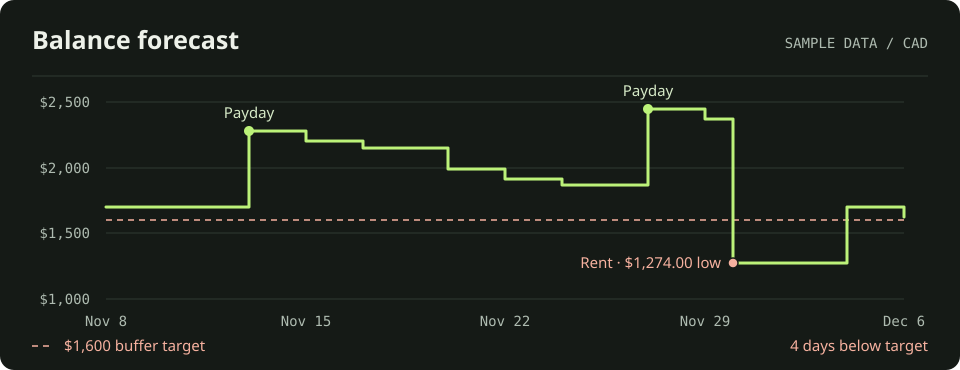

# Buffer · Student Finance Planner

Buffer helps students see how much money they’ll have left after rent, tuition,
and everyday expenses. Enter the balances you have today, schedule the money
coming in and going out, and pick a date to see where you’ll stand.

[Open Buffer](https://bufferfinanceplanner.vercel.app) · [Developer setup](docs/development.md)

*Sample forecast. Even with two paydays, month-end rent briefly pushes the
projected balance below the cash buffer.*

## What you can do

| Feature | How it helps |
| --- | --- |
| **Cash-flow calendar** | Schedule tuition once, pay every two weeks, and rent at month-end. Select a date to see its events and projected closing balance. |
| **Balance trajectory** | Look ahead one month or one year, see when your balance is lowest, and count how many days it falls below a target you set. |
| **Multiple accounts** | Track chequing, savings, and cash from starting balances you enter yourself. See estimated interest and keep CAD, USD, EUR, and GBP totals separate. |
| **Ask Buffer** | Ask a question like “What will my chequing balance be after rent?” or ask to move a planned expense. Review any proposed change before it’s saved. |

Sign in with Google to get started. Buffer projects cash flow from the balances
and schedules you enter manually.

## How it works

- **One forecast engine for the dashboard and AI tools.** The TypeScript engine
  calculates money in integer cents using `bigint`. It counts recurring events
  in constant time per schedule without storing future transactions. A monthly
  event anchored on the 31st falls on February’s last day and returns to the
  31st in March. True month-end schedules always use the last day of the month.
  [Forecast engine](src/lib/finance.ts) · [Edge-case tests](tests/finance.test.mjs)
- **Data ownership enforced in Postgres.** Next.js verifies the Google-backed
  Supabase session before loading the workspace. Row-level security limits
  access to the owner, and a composite foreign key keeps each event tied to an
  account with the same owner and currency.
  [Database design](supabase/README.md) · [Ownership tests](supabase/tests/accounts.sql)
- **A shared tool layer with two ways to use it.** The opt-in Gemini chat calls
  Buffer’s Model Context Protocol (MCP) tools for actual forecast calculations
  and drafts changes for review. External clients such as Codex can use the
  same read tools through `/api/mcp` with an expiring, revocable key. Connections
  are read-only by default, with an option to enable account edits.
  [MCP tools](src/lib/mcp-tools.ts) · [Chat integration](src/lib/ask-buffer.ts)

Built with Next.js App Router, React, TypeScript, and Supabase/Postgres. See the
[developer guide](docs/development.md) for local development, deployment, and
MCP client configuration.
